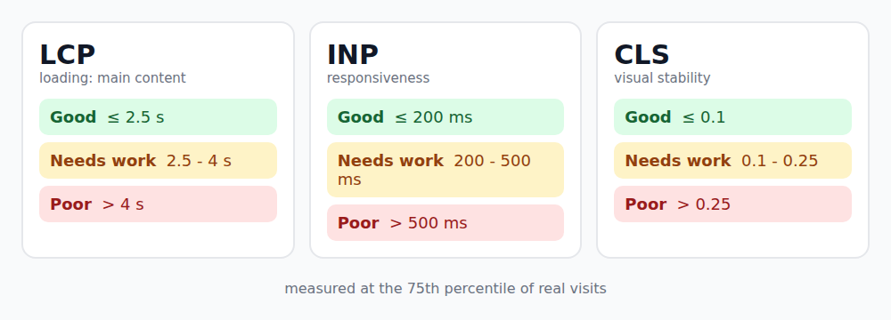

> اطلاعات این مقاله تا آبان ۱۴۰۵ بررسی شده است. آستانه‌ها از زمان جایگزینی INP در مارس ۲۰۲۴ تغییری نکرده‌اند، ولی همیشه صفحه‌ی رسمی web.dev را هم ببینید.

سایت شما می‌تواند در لپ‌تاپ برنامه‌نویس سریع باشد و برای کسی که با گوشی میان‌رده و اینترنت ضعیف وارد می‌شود، کند و پرش‌دار. Core Web Vitals سه معیاری است که گوگل برای سنجیدن همین تجربه‌ی کاربر واقعی تعریف کرده است. در این مقاله هر سه را معرفی می‌کنم و برای هر کدام راه‌حل‌های عملی می‌دهم.

یک توضیح قبل از شروع: این معیارها یکی از چند سیگنالی هستند که گوگل برای رتبه‌بندی استفاده می‌کند. محتوای خوب هنوز مهم‌تر است. ولی تجربه‌ی بد، مستقل از رتبه، کاربر را از دست شما می‌گیرد.

## سه معیار و آستانه‌ها



| معیار | چه چیزی را می‌سنجد | خوب | نیازمند بهبود | ضعیف |
| --- | --- | --- | --- | --- |
| **LCP** | سرعت نمایش بزرگ‌ترین محتوای صفحه | تا 2.5 ثانیه | 2.5 تا 4 ثانیه | بیش از 4 ثانیه |
| **INP** | سرعت واکنش به کلیک، لمس و تایپ | تا 200 میلی‌ثانیه | 200 تا 500 میلی‌ثانیه | بیش از 500 میلی‌ثانیه |
| **CLS** | پایداری چیدمان (پرش نکردن) | تا 0.1 | 0.1 تا 0.25 | بیش از 0.25 |

چند نکته درباره‌ی نحوه‌ی ارزیابی:

- معیار، **صدک ۷۵ام** بازدیدهای واقعی است. برای قبول شدن، دست‌کم ۷۵ درصد بازدیدها باید برای هر سه معیار «خوب» باشند.
- داده از کاربران واقعی (CrUX) می‌آید و در یک بازه‌ی ۲۸ روزه جمع می‌شود. اگر امروز مشکلی را درست کنید، تأثیرش را چند هفته‌ی بعد کامل می‌بینید.
- موبایل و دسکتاپ جدا سنجیده می‌شوند و معمولاً موبایل بدتر است.
- INP در مارس ۲۰۲۴ جای FID را گرفت. FID فقط اولین تعامل را می‌سنجید، ولی INP همه‌ی تعامل‌های یک بازدید را در نظر می‌گیرد.

## LCP: سریع‌تر نشان دهید

LCP معمولاً یک عکس بزرگ یا یک تیتر است. زمان آن از چند بخش تشکیل می‌شود: پاسخ سرور، شروع دانلود، دانلود و رندر. راه‌حل‌های رایج:

- **عکس LCP را lazy نکنید.** `loading="lazy"` برای عکس‌های پایین صفحه خوب است، ولی روی عکس اصلی بالای صفحه LCP را بدتر می‌کند.
- به عکس اصلی اولویت بدهید.
- ابعاد را بنویسید و فرمت مدرن (WebP یا AVIF) و اندازه‌ی مناسب استفاده کنید.
- سرور یا CDN سریع داشته باشید. سایت استاتیک در این مورد برتری دارد.

```html

```

در Astro، کامپوننت `<Image>` همین ویژگی‌ها را می‌گیرد: `loading="eager"` و `fetchpriority="high"` را برای عکس اصلی بگذارید.

## CLS: چیدمان نپرد

پرش چیدمان معمولاً از سه جا می‌آید: عکس بدون ابعاد، فونت وب که دیر لود می‌شود و محتوایی که بالای متن اضافه می‌شود (بنر، تبلیغ).

```css
/* جای عکس را از قبل رزرو کنید */
.cover {
  aspect-ratio: 16 / 9;
  width: 100%;
  height: auto;
}

@font-face {
  font-family: "Vazirmatn";
  src: url("/fonts/Vazirmatn.woff2") format("woff2");
  font-display: swap;
}
```

قاعده‌ی کلی: هر چیزی که ممکن است بعداً لود شود، همین الان برایش جا بگذارید. CLS معمولاً ارزان‌ترین معیار برای اصلاح است، چون بیشتر علت‌ها در HTML و CSS هستند.

## INP: واکنش سریع

INP اغلب سخت‌ترین معیار است. زمان واکنش از سه قسمت تشکیل می‌شود: تأخیر پیش از شروع پردازش، زمان اجرای handler و زمان رسم نتیجه روی صفحه. دشمن اصلی «کار طولانی» (long task) است: هر کاری که بیش از ۵۰ میلی‌ثانیه رشته‌ی اصلی را مشغول کند.

راه‌حل‌ها:

1. **جاوااسکریپت کمتر بفرستید.** هر کیلوبایت اضافه باید parse و اجرا شود. معماری جزیره‌ای Astro یا code-splitting کمک می‌کند.
2. **کارهای سنگین را تکه‌تکه کنید.** بین تکه‌ها اجازه بدهید مرورگر به کاربر پاسخ بدهد.
3. **رویدادهای پرتکرار را debounce کنید.** مثلاً جست‌وجو هنگام تایپ. (راه ساخت `debounce` در مقاله‌ی [Closure در جاوااسکریپت](/fa/articles/javascript-closures-explained) آمده است.)
4. در React برای به‌روزرسانی‌های سنگین از `startTransition` یا `useDeferredValue` استفاده کنید تا ورودی کاربر اولویت داشته باشد.
5. برای بخش‌های خارج از دید، `content-visibility: auto` هزینه‌ی رندر را کم می‌کند.

برای تکه‌تکه کردن، `scheduler.yield()` بهترین گزینه است. این تابع از Chrome 129 (سپتامبر ۲۰۲۴) و Firefox 142 (اوت ۲۰۲۵) پشتیبانی می‌شود، ولی تا زمان نوشتن، Safari آن را ندارد. پس یک جایگزین لازم است:

```js
function yieldToMain() {
  if (globalThis.scheduler?.yield) {
    return scheduler.yield();
  }
  return new Promise((resolve) => setTimeout(resolve, 0));
}

async function processItems(items) {
  let lastYield = performance.now();

  for (const item of items) {
    handleItem(item);

    // هر حدود ۴۰ میلی‌ثانیه به مرورگر فرصت بدهید
    if (performance.now() - lastYield > 40) {
      await yieldToMain();
      lastYield = performance.now();
    }
  }
}
```

## اندازه‌گیری: فقط به Lighthouse تکیه نکنید

امتیاز Lighthouse یک آزمایش در شرایط ثابت (lab) است. Core Web Vitals با داده‌ی واقعی کاربران (field) سنجیده می‌شود. ممکن است Lighthouse ۱۰۰ بدهد و کاربران واقعی شما در موبایل ضعیف تجربه‌ی بدی داشته باشند. ابزارها:

- **PageSpeed Insights:** هم داده‌ی واقعی (CrUX) و هم آزمایش Lighthouse را نشان می‌دهد.
- **Search Console:** گزارش Core Web Vitals برای کل سایت و گروه‌بندی صفحه‌ها.
- **تب Performance در DevTools:** برای پیدا کردن کار طولانی و تعامل کند.
- **کتابخانه‌ی web-vitals:** اندازه‌گیری از کاربران واقعی خودتان:

```js
import { onLCP, onINP, onCLS } from "web-vitals";

function send(metric) {
  navigator.sendBeacon(
    "/analytics",
    JSON.stringify({ name: metric.name, value: metric.value, id: metric.id })
  );
}

onLCP(send);
onINP(send);
onCLS(send);
```

## یک روند کاری ساده

1. در Search Console یا PageSpeed ببینید کدام معیار و کدام گروه صفحه‌ها «ضعیف» است.
2. مشکل را در DevTools با شبیه‌سازی موبایل و کند کردن CPU بازتولید کنید.
3. یک چیز را درست کنید و دوباره اندازه بگیرید.
4. تا ۲۸ روز بعد صبر کنید تا داده‌ی واقعی تأیید کند.

## جمع‌بندی

- آستانه‌ها: LCP تا 2.5 ثانیه، INP تا 200 میلی‌ثانیه، CLS تا 0.1، در صدک ۷۵ام.
- برای LCP عکس اصلی را سریع و بدون lazy بارگذاری کنید.
- برای CLS برای هر چیز ناشناخته جا رزرو کنید.
- برای INP کارهای طولانی را بشکنید و جاوااسکریپت را کم کنید.
- همیشه با داده‌ی واقعی بسنجید، نه فقط با Lighthouse.

## منابع

- [Core Web Vitals در web.dev](https://web.dev/articles/vitals)
- [تعریف آستانه‌های Core Web Vitals](https://web.dev/articles/defining-core-web-vitals-thresholds)
- [بهینه‌سازی کارهای طولانی](https://web.dev/articles/optimize-long-tasks)
- [استفاده از scheduler.yield()](https://developer.chrome.com/blog/use-scheduler-yield)
- [کتابخانه‌ی web-vitals](https://github.com/GoogleChrome/web-vitals)
- [PageSpeed Insights](https://pagespeed.web.dev/)
