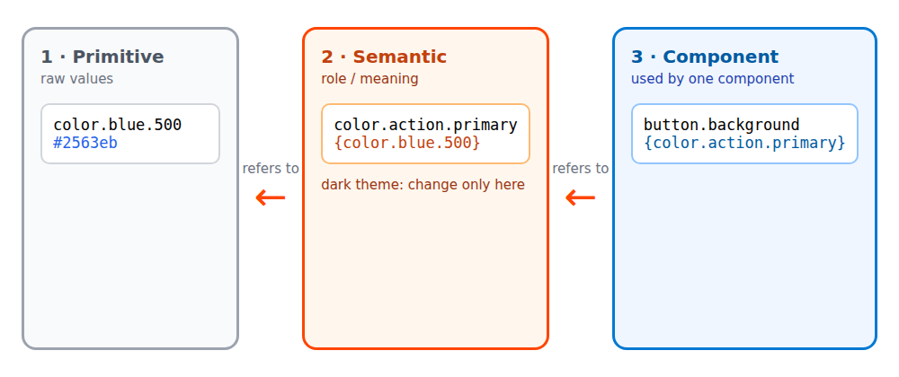

> اطلاعات این مقاله تا آبان ۱۴۰۵ بررسی شده است. ابزارها سریع تغییر می‌کنند، پس پیش از استفاده، مستندات رسمی را هم ببینید. لینک منابع در پایان مقاله آمده است.

وقتی تیمی می‌گوید «سیستم دیزاین می‌خواهیم»، معمولاً منظورش یک کتابخانه‌ی دکمه و فرم است. ولی کتابخانه‌ی کامپوننت فقط بخش دیدنی کار است. زیر آن، مجموعه‌ای از تصمیم‌ها قرار دارد: رنگ‌ها، فاصله‌ها، فونت‌ها و حرکت. اگر این تصمیم‌ها جایی ثبت نشوند، هر کامپوننت کم‌کم آبی مخصوص خودش را پیدا می‌کند.

در این مقاله از همین تصمیم‌ها (توکن‌ها) شروع می‌کنیم و تا کامپوننت و مستندسازی می‌رویم. هر جا چیزی در یکی دو سال اخیر تغییر کرده، به آن اشاره می‌کنم.

## سیستم دیزاین از چه بخش‌هایی تشکیل می‌شود؟

- **توکن‌ها:** تصمیم‌های طراحی به‌شکل داده، مثل رنگ، فاصله و شعاع گوشه.
- **کامپوننت‌ها:** دکمه، فیلد، دیالوگ و مانند آن‌ها که از توکن‌ها ساخته می‌شوند.
- **مستندات:** نمونه‌ی زنده و راهنمای استفاده برای هر کامپوننت.
- **فرایند:** چه کسی تغییر را تأیید می‌کند و نسخه‌ها چطور منتشر می‌شوند.

اگر فقط کتابخانه‌ی کامپوننت بسازید و بقیه را نادیده بگیرید، چند ماه بعد دوباره به ناهماهنگی می‌رسید. پس از پایین‌ترین لایه شروع می‌کنیم.

## توکن‌ها در سه لایه

یک اشتباه رایج این است که همه‌ی رنگ‌ها را در یک فهرست بریزند و مستقیم داخل کامپوننت‌ها صدا بزنند. تیم‌ها معمولاً توکن‌ها را در سه لایه سازمان می‌دهند:



1. **توکن‌های پایه (primitive):** مقدارهای خام، مثل `color.blue.500`. نام آن‌ها می‌گوید چیست، نه اینکه کجا استفاده می‌شود.
2. **توکن‌های معنایی (semantic):** نقش را بیان می‌کنند، مثل `color.action.primary`. هر کدام به یک توکن پایه اشاره می‌کند.
3. **توکن‌های کامپوننت:** مثل `button.background` که به یک توکن معنایی اشاره می‌کند.

مزیت این ساختار موقع تغییر تم معلوم می‌شود. برای تم تیره فقط اشاره‌ی لایه‌ی معنایی را عوض می‌کنید، مثلاً `action.primary` به یک آبی روشن‌تر اشاره کند، و هیچ کامپوننتی را لازم نیست دست بزنید.

## DTCG: فرمت مشترک بین طراح و برنامه‌نویس

سال‌ها هر ابزار توکن‌ها را با فرمت خودش ذخیره می‌کرد و انتقال بین Figma، ابزارهای build و کد دردسر داشت. گروه Design Tokens Community Group (یک گروه جامعه‌ی W3C) در ۲۸ اکتبر ۲۰۲۵ اولین نسخه‌ی پایدار مشخصاتش را با نام **2025.10** منتشر کرد. این یک فرمت JSON مستقل از ابزار برای تبادل توکن‌هاست. نمونه‌ی کوتاه:

```json
{
  "color": {
    "$type": "color",
    "blue": {
      "500": {
        "$value": {
          "colorSpace": "srgb",
          "components": [0.145, 0.388, 0.922],
          "hex": "#2563eb"
        }
      }
    },
    "action": {
      "primary": { "$value": "{color.blue.500}" }
    }
  },
  "space": {
    "$type": "dimension",
    "4": { "$value": { "value": 16, "unit": "px" } }
  }
}
```

چند نکته درباره‌ی این فرمت:

- `$type` را می‌شود روی گروه گذاشت و همه‌ی توکن‌های داخل آن به ارث می‌برند.
- ارجاع به توکن دیگر با آکولاد نوشته می‌شود، مثل `"{color.blue.500}"`. لایه‌های بالای تصویر بالا همین‌طور ساخته می‌شوند.
- مقدار رنگ دیگر فقط رشته‌ی `#2563eb` نیست. فضای رنگ (`colorSpace`) و مؤلفه‌ها را جدا می‌نویسید. به همین دلیل رنگ‌های مدرن، مثل Display P3 یا OKLCH، هم قابل بیان‌اند.
- اندازه‌ها هم ساختار دارند: `{ "value": 16, "unit": "px" }`.

یک احتیاط: پشتیبانی ابزارها یکدست نیست. بعضی هنوز فقط نسخه‌ی پیش‌نویس قدیمی‌تر را می‌خوانند. پیش از مهاجرت، مستندات ابزار خودتان را بررسی کنید.

## از JSON به CSS

مرورگر JSON توکن را نمی‌فهمد. باید در مرحله‌ی build به CSS تبدیل شود. ابزارهایی مثل Style Dictionary (که از نسخه‌ی ۴ فرمت DTCG را می‌خواند) و Terrazzo این کار را می‌کنند. خروجی دلخواه چیزی شبیه این است:

```css
:root {
  --color-blue-500: #2563eb;
  --color-action-primary: var(--color-blue-500);
  --space-4: 1rem;
}
```

اگر از Tailwind v4 استفاده می‌کنید، تنظیمات در خود CSS و با `@theme` نوشته می‌شود. هر متغیر در این بخش، علاوه بر متغیر CSS، یک کلاس ابزار هم می‌سازد:

```css
@import "tailwindcss";

@theme {
  --color-brand: #2563eb;
  --radius-card: 0.75rem;
}
```

بعد از این می‌توانید `bg-brand` و `rounded-card` را در HTML بنویسید. Terrazzo یک پلاگین دارد که تم Tailwind v4 را مستقیم از توکن‌های DTCG می‌سازد.

## تم‌بندی با CSS مدرن

چند قابلیت CSS کار تم‌بندی را خیلی ساده‌تر کرده‌اند.

**`light-dark()`** دو رنگ می‌گیرد: اولی برای حالت روشن و دومی برای حالت تیره. فقط لازم است `color-scheme` تنظیم شده باشد. این تابع از مه ۲۰۲۴ در مرورگرهای اصلی در دسترس است و فقط با رنگ کار می‌کند، نه با کل سایه:

```css
:root {
  color-scheme: light dark;
  --surface: light-dark(#ffffff, #121212);
  --text: light-dark(#1a1a1a, #f2f2f2);
}

/* یک بخش را مجبور به تم تیره کنید */
.panel-dark {
  color-scheme: dark;
}
```

**`@layer`** ترتیب اولویت استایل‌ها را بدون جنگ با specificity مشخص می‌کند. لایه‌ی توکن‌ها اول می‌آید، بعد پایه، بعد کامپوننت‌ها:

```css
@layer tokens, base, components, utilities;
```

**`@scope`** به شما اجازه می‌دهد استایل را به یک بخش از DOM محدود کنید و مرز پایین هم تعیین کنید. طبق منابع، پشتیبانی آن با Firefox 146 (دسامبر ۲۰۲۵) در همه‌ی موتورهای اصلی کامل شد (Chrome از نسخه‌ی 118 و Safari از 17.4):

```css
@scope (.card) to (.card-footer) {
  a {
    color: var(--color-action-primary);
  }
}
```

قبل از استفاده، پشتیبانی مرورگرهای مخاطبان خودتان را در caniuse یا MDN بررسی کنید.

## کامپوننت‌ها: React، Web Component یا هر دو؟

اگر محصول شما فقط یک فریم‌ورک دارد، ساده‌ترین مسیر کامپوننت‌های همان فریم‌ورک است که توکن‌ها را به‌شکل CSS variable مصرف می‌کنند. Web Components وقتی ارزش پیدا می‌کنند که یک کامپوننت باید در چند فریم‌ورک یا در صفحه‌هایی که شما کنترل نمی‌کنید کار کند.

قابلیت‌های مهم آن‌ها برای سیستم دیزاین:

- Shadow DOM استایل‌ها را ایزوله می‌کند.
- متغیرهای CSS از مرز Shadow DOM عبور می‌کنند. پس توکن‌ها بی‌دردسر کار می‌کنند.
- با `::part()` و slot می‌شود بخش‌های مشخصی را قابل شخصی‌سازی گذاشت.

یک نمونه‌ی کوچک:

```js
class PjsButton extends HTMLElement {
  constructor() {
    super();
    this.attachShadow({ mode: "open" }).innerHTML = `
      <style>
        button {
          background: var(--color-action-primary, #2563eb);
          color: var(--color-on-action, #fff);
          border: 0;
          border-radius: var(--radius-card, 0.75rem);
          padding: 0.5rem 1rem;
          font: inherit;
          cursor: pointer;
        }
        button:focus-visible {
          outline: 2px solid currentColor;
          outline-offset: 2px;
        }
      </style>
      <button part="button"><slot></slot></button>
    `;
  }
}

customElements.define("pjs-button", PjsButton);
```

استفاده: `<pjs-button>ذخیره</pjs-button>`.

هزینه‌ها را هم بشناسید. دکمه‌ی داخل Shadow DOM به‌طور پیش‌فرض با فرم بیرونی ارتباط ندارد و برای فیلدهای فرم باید از `ElementInternals` کمک بگیرید. رندر سمت سرور هم باید با Declarative Shadow DOM هماهنگ شود. تجربه‌ی توسعه هم با کتابخانه‌هایی مثل React فرق دارد. این‌ها دلیل نیستند که Web Components را کنار بگذارید، ولی باید قبل از انتخاب حسابشان را بکنید.

## مستندسازی و تست با Storybook

مستندسازی کامپوننت‌ها بدون یک جای مشترک برای دیدنشان کار نمی‌کند. Storybook رایج‌ترین انتخاب است. نسخه‌ی ۱۰ آن در نوامبر ۲۰۲۵ آمد و این تغییرها را دارد:

- فقط ESM را پشتیبانی می‌کند. این تنها تغییر شکننده‌ی آن است و به Node نسخه‌ی 20.16 به بعد، 22.19 به بعد یا 24 نیاز دارد.
- حجم نصب آن حدود ۲۹ درصد کمتر از نسخه‌ی ۹ است.
- module automocking برای تست را اضافه کرده است.
- CSF Factories (فعلاً برای React) نوشتن story را با تایپ‌اسکریپت امن‌تر می‌کند.

از نسخه‌ی ۹ به بعد تست کامپوننت در Storybook روی Vitest سوار شده است. یک قاعده‌ی خوب: برای هر حالت مهم کامپوننت (عادی، غیرفعال، خطا، در حال بارگذاری) یک story بنویسید و بررسی‌های دسترس‌پذیری را در CI اجرا کنید.

## نگهداری: نسخه‌بندی و مالکیت

یک سیستم دیزاین بدون قانون نگهداری زود از هم می‌پاشد. چند قاعده‌ی ساده:

- تغییر نام یا حذف یک توکن را تغییر شکننده (major) حساب کنید.
- توکن قدیمی را حداقل یک نسخه به‌صورت `deprecated` نگه دارید و به جایگزین اشاره کنید.
- برای هر تغییر، changelog بنویسید.
- یک نفر یا یک گروه کوچک مسئول تأیید تغییرها باشد.

## از کجا شروع کنیم؟

1. همه‌ی رنگ‌ها و فاصله‌هایی را که الان در محصول هست فهرست کنید. معمولاً تعداد زیاد و تکراری‌شان تعجب‌آور است.
2. ۱۰ تا ۱۵ توکن معنایی بسازید، نه صدتا.
3. توکن‌ها را در JSON با فرمت DTCG نگه دارید و در build به CSS تبدیل کنید.
4. چهار کامپوننت پایه بسازید: دکمه، فیلد متنی، چک‌باکس و دیالوگ.
5. هر کدام را در Storybook مستند کنید.
6. از روز اول `:focus-visible`، کنتراست رنگ و پشتیبانی کیبورد را رعایت کنید.

در رویداد دسامبر ۲۰۲۵ جامعه‌ی PersiaJS هم درباره‌ی این موضوع صحبت شد. صفحه‌ی [رویداد Design Systems و Web Components](/events/persiajs-december-2025-design-systems-web-components) را ببینید.

## منابع

- [اعلام اولین نسخه‌ی پایدار Design Tokens (W3C)](https://www.w3.org/community/design-tokens/2025/10/28/design-tokens-specification-reaches-first-stable-version/)
- [Design Tokens Format Module 2025.10](https://www.designtokens.org/TR/2025.10/format/)
- [Design Tokens Color Module 2025.10](https://www.designtokens.org/TR/2025.10/color/)
- [Storybook 10](https://storybook.js.org/blog/storybook-10/)
- [مستندات Terrazzo: پلاگین Tailwind](https://terrazzo.app/docs/integrations/tailwind/)
- [MDN: light-dark()](https://developer.mozilla.org/en-US/docs/Web/CSS/color_value/light-dark)
- [MDN: @scope](https://developer.mozilla.org/en-US/docs/Web/CSS/@scope)
