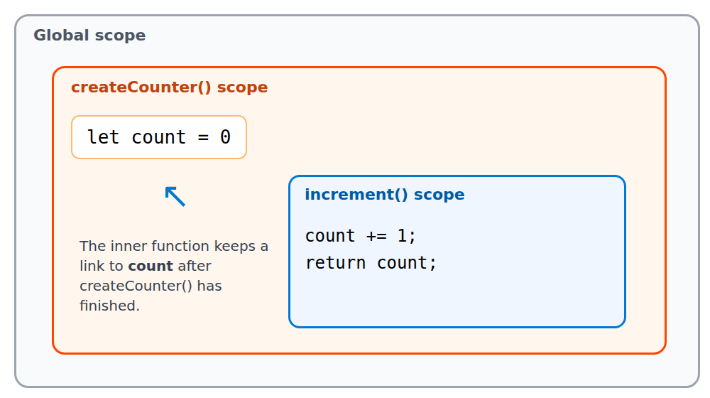

تقریباً در هر مصاحبه‌ی جاوااسکریپت یک سؤال درباره‌ی closure پرسیده می‌شود، ولی ارزش اصلی آن در کار روزمره است. تابع‌های `debounce`، حالت خصوصی در ماژول‌ها و بسیاری از hookهای React همه روی closure ساخته شده‌اند. در این مقاله اول مفهوم را ساده توضیح می‌دهیم، بعد سراغ اشتباه‌های رایج و کاربردهای واقعی می‌رویم.

## Closure چیست؟

هر تابع در جاوااسکریپت موقع ساخته شدن، به **محیط لغوی** (lexical environment) اطرافش وصل می‌شود. یعنی به متغیرهایی که در آن لحظه در دسترس بودند. Closure همین ترکیب است: **تابع به‌علاوه‌ی دسترسی به متغیرهای محیطی که در آن ساخته شده**.

مثال زیر را ببینید:

```js
function createCounter() {
  let count = 0;

  return {
    increment() {
      count += 1;
      return count;
    },
    reset() {
      count = 0;
    },
  };
}

const counter = createCounter();
console.log(counter.increment()); // 1
console.log(counter.increment()); // 2
```

تابع `createCounter` تمام شده و از بین رفته، ولی `increment` هنوز به `count` دسترسی دارد. دلیلش این است که `increment` یک closure است و متغیر `count` را زنده نگه می‌دارد.



> هیچ‌کس بیرون از `createCounter` نمی‌تواند مستقیماً `count` را تغییر دهد. فقط از راه `increment` و `reset` می‌شود به آن دست زد.

## اشتباه کلاسیک: حلقه با var

این مثال را حتماً دیده‌اید:

```js
for (var i = 0; i < 3; i++) {
  setTimeout(() => console.log(i), 0);
}
// خروجی: 3 3 3
```

سه تابع همه به **یک** متغیر `i` اشاره می‌کنند، چون `var` به محدوده‌ی تابع تعلق دارد، نه به هر دور حلقه. تا وقتی `setTimeout` اجرا می‌شود، حلقه تمام شده و `i` برابر ۳ است. با `let` هر دور حلقه متغیر مخصوص خودش را دارد:

```js
for (let j = 0; j < 3; j++) {
  setTimeout(() => console.log(j), 0);
}
// خروجی: 0 1 2
```

| تعریف متغیر حلقه | خروجی | دلیل |
| --- | --- | --- |
| `var` | `3 3 3` | یک متغیر مشترک برای همه‌ی دورها |
| `let` | `0 1 2` | هر دور متغیر جداگانه دارد |

## کاربردهای واقعی

### ۱. حالت خصوصی

همان مثال `createCounter` را ببینید. قبل از آمدن فیلدهای خصوصی کلاس (`#field`)، این روش اصلی ساخت داده‌ی پنهان بود و هنوز هم در کد تابعی زیاد استفاده می‌شود.

### ۲. debounce

وقتی کاربر در یک فیلد جست‌وجو تایپ می‌کند، نمی‌خواهیم برای هر حرف درخواست بفرستیم. `debounce` تابع را تا زمان مشخصی بعد از آخرین فراخوانی عقب می‌اندازد:

```js
function debounce(fn, delay = 300) {
  let timerId;

  return (...args) => {
    clearTimeout(timerId);
    timerId = setTimeout(() => fn(...args), delay);
  };
}

const search = debounce((text) => console.log("Searching:", text), 400);
```

متغیر `timerId` بین فراخوانی‌ها باقی می‌ماند، چون تابع برگشتی آن را در closure نگه داشته است.

### ۳. memoize

برای ذخیره‌ی نتیجه‌ی محاسبه‌های سنگین:

```js
function memoize(fn) {
  const cache = new Map();

  return (arg) => {
    if (cache.has(arg)) return cache.get(arg);
    const result = fn(arg);
    cache.set(arg, result);
    return result;
  };
}

const slowSquare = (n) => n * n;
const fastSquare = memoize(slowSquare);
```

## دام رایج در React: stale closure

در کامپوننت‌های React هر رندر یک تابع تازه می‌سازد که مقدارهای همان رندر را در closure خودش دارد. اگر `useEffect` فقط یک بار اجرا شود، مقدار قدیمی را می‌بیند:

```jsx
function Timer() {
  const [count, setCount] = useState(0);

  useEffect(() => {
    const id = setInterval(() => {
      setCount(count + 1); // count همیشه 0 است
    }, 1000);
    return () => clearInterval(id);
  }, []);

  return <p>{count}</p>;
}
```

عدد روی صفحه از ۱ جلوتر نمی‌رود، چون `count` داخل interval همان مقدار اولیه‌ی ۰ است. راه‌حل، استفاده از شکل تابعی `setState` است:

```jsx
setCount((c) => c + 1);
```

این‌بار React مقدار فعلی را خودش به تابع می‌دهد و به closure قدیمی وابسته نیستیم.

## حواستان به حافظه باشد

Closure متغیرهایی را که به آن‌ها اشاره می‌کند زنده نگه می‌دارد. اگر closure به یک داده‌ی بزرگ اشاره کند و خودش جایی نگه داشته شود، آن داده آزاد نمی‌شود. نمونه‌اش listenerهایی است که پاک نشده‌اند. برای جزئیات بیشتر درباره‌ی اینکه موتور V8 چطور حافظه را پاک می‌کند، [مقاله‌ی Garbage Collection](/fa/articles/v8-garbage-collection) را بخوانید.

## جمع‌بندی

- Closure یعنی تابع به‌علاوه‌ی دسترسی به متغیرهای محیطی که در آن ساخته شده.
- `var` در حلقه یک متغیر مشترک می‌سازد و `let` برای هر دور یک متغیر جدا.
- از closure برای حالت خصوصی، `debounce` و `memoize` استفاده می‌شود.
- در React مراقب stale closure باشید و در صورت نیاز از شکل تابعی `setState` استفاده کنید.
- Closure حافظه را نگه می‌دارد. اگر دیگر لازم نیست، رهایش کنید.

اگر تجربه‌ی دیگری از closure دارید، در بحث تلگرام یا لینکدین با ما در میان بگذارید.
